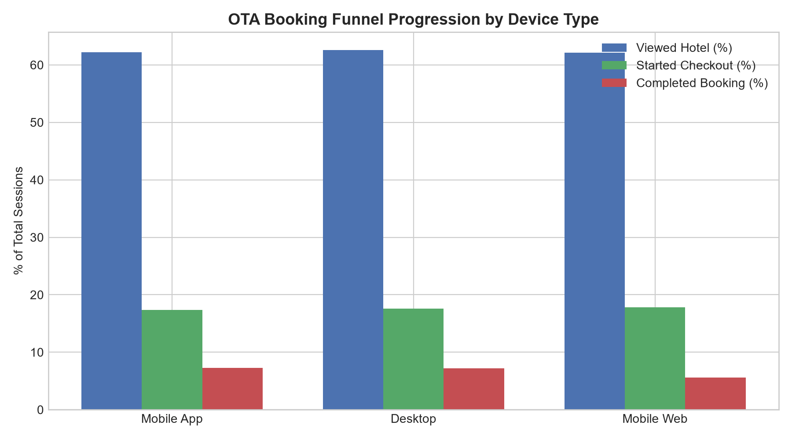
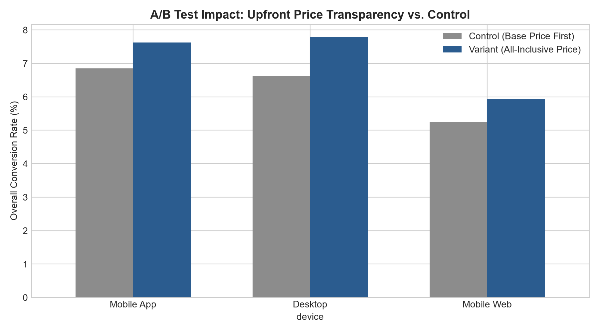

# Hotel Booking Funnel & A/B Experimentation Case Study

End-to-end product analytics project evaluating checkout drop-off and testing **Upfront All-Inclusive Price Transparency** across 100,000 simulated Online Travel Agency (OTA) booking sessions using **SQL** and **Python**.

---

### 1. Business Problem & Hypothesis
* **Problem:** Funnel diagnostics across 100,000 sessions revealed that `mobile_web` converted at only **5.59%**, lagging significantly behind `mobile_app` (**7.24%**) and `desktop` (**7.21%**) due to late tax and fee surprises at checkout.
* **Hypothesis:** Displaying all-inclusive pricing upfront (`variant`) instead of base room rates first (`control`) will reduce checkout abandonment and increase overall booking conversion without hurting Average Order Value (AOV).

---

### 2. Key Experiment Results

| Metric | Control (Base Price) | Variant (All-Inclusive) | Impact / Verdict |
| :--- | :--- | :--- | :--- |
| **Sessions (`n`)** | 49,798 | 50,202 | SRM Check Passed ($p = 0.2014$) |
| **Overall Conversion Rate (CVR)** | 6.243% | 7.065% | **+0.822% abs / +13.17% rel lift** ($p < 0.0001$) |
| **95% Confidence Interval** | — | — | **[+0.513%, +1.131%]** |
| **Average Order Value (AOV)** | $144.49 | $148.97 | No cannibalization ($p = 0.0565$) |
| **Revenue Per Session (RPS)** | $9.02 | $10.53 | **+$1.50 per session (+16.6%)** |

---

### 3. Visual Insights

#### Booking Funnel Progression by Device Type

#### A/B Test Conversion Lift by Device Segment

---

### 4. Product Recommendation
1. **Ship `variant` to 100% of users:** Upfront price transparency delivered a statistically significant **+13.17% relative lift** in booking conversion ($Z = 5.216, p < 0.0001$) and generated **+$1.50 in incremental revenue per session**.
2. **Prioritize Mobile Web Checkout UX:** Because `mobile_web` still exhibits the lowest baseline conversion (**5.59%**), follow up with streamlined one-tap payment options (Apple Pay / Google Pay / local wallets) to close the gap with `mobile_app`.

---

### 5. Repository Structure & Tech Stack
* **`data/generate_data.py`**: Simulates 100,000 multi-device, multi-country OTA user sessions (`TH`, `SG`, `MY`, `BD`, `JP`).
* **`sql/funnel_analysis.sql`**: Production SQL queries using CTEs, conditional aggregation, and window functions for funnel drop-offs, GMV share, and segment lift.
* **`notebooks/ab_test_analysis.py`**: Runs SQLite queries, Sample Ratio Mismatch (SRM) chi-square validation, two-proportion Z-tests, Welch's t-test on AOV guardrails, and generates charts.
* **Tools:** Python (`pandas`, `numpy`, `scipy`, `statsmodels`, `matplotlib`), SQL (PostgreSQL / SQLite).
